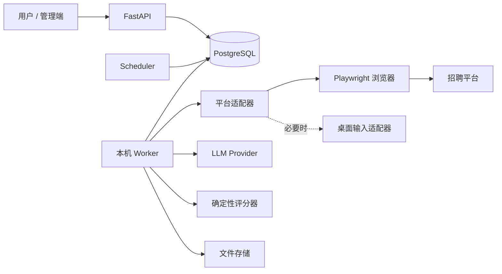

# 技术栈与系统架构

## 1. 技术选择

| 层 | 选择 | 理由 |
|---|---|---|
| 语言/API | Python 3.12+、FastAPI、Pydantic 2 | 满足指定技术栈，结构化契约与输入校验 |
| 数据 | PostgreSQL、SQLAlchemy 2、Alembic、psycopg 3 | 事务、唯一约束、JSONB、关系查询与版本迁移 |
| 后台任务 | PostgreSQL 持久任务队列 + 独立 Python worker | 单机首期减少基础设施，任务租约与重启恢复可控 |
| 周期任务 | 独立 scheduler 进程，数据库保存计划 | 避免多个 API worker 重复启动调度 |
| 网页交互 | Playwright Python，Chromium 有界面模式 | 支持鼠标、键盘、上传、DOM 获取和浏览器上下文 |
| 原生桌面 | PyAutoGUI 可选适配器，首期只预留 | 仅在无法通过浏览器完成的系统控件上使用，依赖交互桌面 |
| 内容提取 | DOM 优先，BeautifulSoup 辅助清洗 | 保留正文与证据，减少页面噪声 |
| AI | httpx + LLMProvider 协议 + Pydantic JSON 校验 | 服务商待定，可切换云端或本地；不强依赖 Agent 框架 |
| 文件 | 本地 artifacts 目录，Storage 协议 | 简历、网页快照和截图；后续可换 S3 兼容存储 |
| 管理界面 | 首期 FastAPI OpenAPI 文档 + 简单管理页（后续实现） | 先完成业务闭环，暂不引入独立前端工程 |
| 运维/验证 | 标准 logging、结构化日志、pytest、Playwright 测试页面 | 验证评分、幂等与真实交互边界 |

具体依赖小版本在实现时锁定并验证兼容性。首期不引入 Redis/Celery、向量库和 Elasticsearch；规模增长时通过任务/存储接口替换。

## 2. 组件关系



逻辑上分模块，部署上为模块化单体：API、worker、scheduler 三个进程共享数据库。浏览器运行在 Windows 用户登录桌面，数据库可使用本地服务或容器。不要把原生桌面控制放入无显示的 Linux 容器；每个桌面执行器同一时刻只运行一个操作。

## 3. 模块边界与建议目录（未来实现）

```text
app/
  api/              HTTP 路由、鉴权与 DTO
  domain/           职位、能力档案、评分和投递规则
  services/         搜索、分析、申请用例编排
  adapters/
    platforms/      每个平台独立适配器
    browser/        Playwright 与可选桌面输入
    llm/            模型供应商适配器
    storage/        文件与加密会话存储
  persistence/      ORM、事务、repository
  workers/          租约、任务处理、心跳
  scheduler/        周期任务派发
tests/
artifacts/          不纳入 Git
```

路由不直接操作浏览器，LLM 不直接控制提交。评分器是纯业务逻辑，平台差异仅放在适配器中。

## 4. 执行流程与一致性

1. API 校验配置，在同一数据库事务中创建 run 和 task，返回 202。
2. worker 使用 `FOR UPDATE SKIP LOCKED` 领取任务，写租约与心跳；租约超时后由恢复程序检查。
3. 搜索与详情采集生成职位快照，创建分析任务；结构化提取结果经过 schema 校验。
4. 分析绑定岗位快照、档案版本和规则版本；评分通过后创建唯一 application 和投递任务。
5. 投递前重新校验守卫，并在事务中预留日额度；使用平台账户执行器锁串行操作浏览器。
6. 外部提交前持久化 submitting 与 attempt；成功记录凭据，明确未提交可失败，无法确定是否已提交则标记 unknown。
7. 崩溃恢复遇到 submitting/unknown 先执行 reconcile 查询申请记录。无法确认时等待人工处理。

队列提供至少一次派发，业务通过唯一约束和状态迁移实现幂等。数据库事务无法与外部网站构成原子事务，不能承诺网站端严格 exactly-once。

暂停检查点：导航前、分析前、提交前；暂停后保留任务。取消阻止后续阶段，已发生的外部提交仍记录结果。默认搜索请求最多重试 3 次，指数退避，平台限流按账户隔离。投递恢复使用专用核查流程。

## 5. 安全、可观测性与容量

- 默认绑定 127.0.0.1；写接口使用 Bearer token，浏览器管理页防 CSRF；对外部署另行加入用户身份与资源隔离。
- 简历、Cookie、会话文件不进 Git；会话加密密钥放系统凭据存储或环境配置，数据库只存引用。
- AI 默认只接收必要的技能证据与职位要求，不发送身份证、住址、联系方式；简历按需直接上传招聘平台。
- 浏览器与 AI 可访问目标受适配器/平台白名单约束；职位外链不得成为任意 URL 抓取入口。
- 记录 run_id/task_id/application_id、阶段耗时、模型版本/调用成本、错误类别。截图和正文可能含个人信息，访问需鉴权。
- 初始目标：单用户单平台、每日最多 200 个职位分析、20 份投递；这些是设计容量，实际速度取决于平台限制和模型延迟，不是性能实测。
- 原文/截图默认保存 30 天，投递审计 180 天，可配置；被审计引用的证据清理前保留必要摘要和文件散列。数据库与文件备份配套，删除档案时处理相关个人数据。

## 6. 选型参考

- [FastAPI 数据库集成](https://fastapi.tiangolo.com/tutorial/sql-databases/)：框架不绑定数据库工具，本项目选择 SQLAlchemy。
- [Playwright 输入操作](https://playwright.dev/python/docs/input)：覆盖点击、按键和上传。
- [Playwright 自动等待](https://playwright.dev/python/docs/actionability)：使用定位器和状态等待，减少固定延时。
- [PostgreSQL pg_trgm](https://www.postgresql.org/docs/17/pgtrgm.html)：后续可辅助疑似重复检索，不能代替身份唯一约束。
