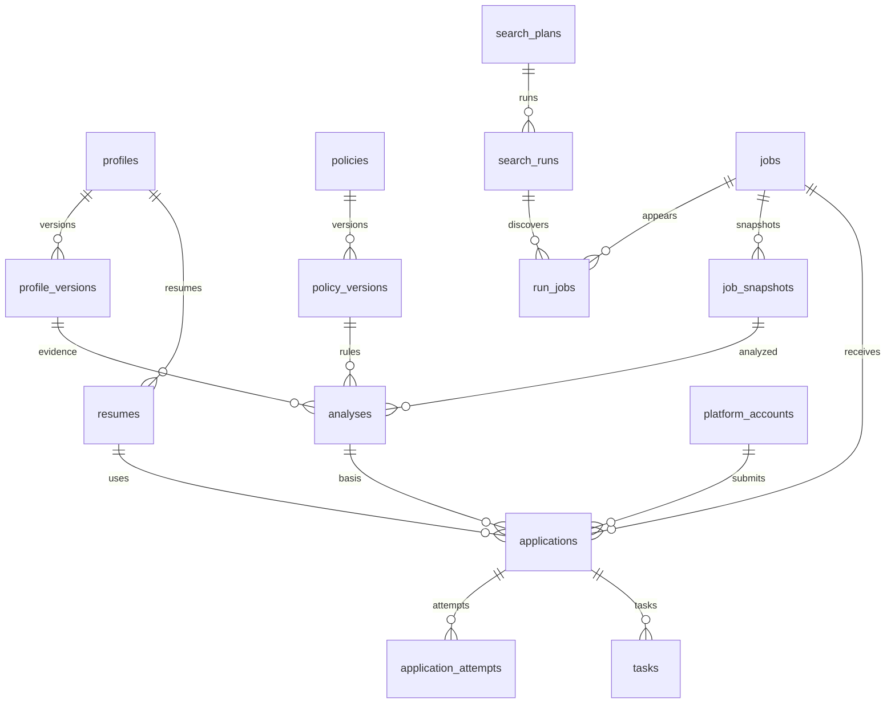

# 数据库设计（PostgreSQL 逻辑模型）

第二步已依据本设计实现 PostgreSQL 模型和初始迁移，详见 `app/models.py` 与 `migrations/versions/0001_initial.py`。除资源租约使用 resource_key 为主键外，主键为 UUID；时间为 timestamptz。各表包含 created_at/updated_at（executor_leases 除外），不可变版本的更新时间固定为创建时间。分数 numeric(9,6)，散列使用 SHA-256。业务对象使用状态归档，含审计引用的记录不直接级联删除。

模型使用 SQLAlchemy Core，Session 执行事务，不引入 ORM 对象关系映射。版本/快照/简历禁止 UPDATE 与 DELETE；审计记录只允许追加。循环指针采用复合外键，申请的档案/分析/职位/平台归属由触发器校验。原始 SQL 若需生成 UUID 须显式传入；SQLAlchemy 插入时由 Python 默认生成。updated_at 由 SQLAlchemy 更新语句自动维护，原始 SQL 调用者需显式维护。

enqueue_application 原子完成去重、当前版本校验、策略/会话状态检查、候选人跨账户日额度预留、申请及任务写入；完整提交守卫、额度消费/释放、执行器资源租约算法和异常恢复将在后续业务阶段实现。日额度通过预留时间落在当前策略时区的自然日区间统计，不按账户分别放宽。

## 1. 表结构

| 表 | 主要字段（除 id） | 关系与约束 |
|---|---|---|
| profiles | name varchar(100), current_version_id UUID?, default_resume_id UUID? | 单个求职者根对象；当前版本/简历必须属于自身 |
| profile_versions | profile_id, version int, skills JSONB, experience_years numeric, education JSONB, preferences JSONB, facts JSONB | FK profiles；UNIQUE(profile_id,version)，不可变 |
| resumes | profile_id, version int, artifact_id, sha256 char(64), original_filename, mime_type, size bigint | FK profiles/artifacts；UNIQUE(profile_id,version)，版本不可变 |
| platform_accounts | platform_key, label, session_secret_ref, session_status, verified_at, enabled bool | 会话只存加密存储引用；状态 unknown/valid/expired/needs_input |
| policies | name, current_version_id | 版本归属校验 |
| policy_versions | policy_id, version, threshold numeric, comparison, daily_limit int, timezone, auto_apply bool, blocked_companies JSONB, allowed_platforms JSONB, scoring_rule_version, equivalence_map JSONB | UNIQUE(policy_id,version)；threshold 0–100，daily_limit>0；不可变 |
| search_plans | name, profile_id, policy_id, config JSONB, version int, schedule_cron?, timezone, enabled, next_run_at? | FK profiles/policies，配置使用 API schema 校验 |
| search_runs | plan_id, plan_version, profile_version_id, policy_version_id, config_snapshot JSONB, mode, status, scheduled_for?, started_at?, finished_at?, error JSONB | 冻结配置；周期派发 UNIQUE(plan_id,scheduled_for)，手动运行为 null |
| jobs | platform_key, external_job_id?, canonical_url, identity_key, company_name, title, status, latest_snapshot_id?, first_seen_at,last_seen_at | UNIQUE(platform_key,identity_key)，有 ID 用 ID，否则规范 URL；同平台 identity 合并需显式别名映射 |
| job_snapshots | job_id, content_hash, raw_artifact_id, normalized JSONB, captured_at, extractor_version | UNIQUE(job_id,content_hash)；不可变，normalized 保留单位和原文 |
| run_jobs | run_id, job_id, snapshot_id | UNIQUE(run_id,job_id)，记录本轮实际看到的版本 |
| analyses | job_snapshot_id, profile_version_id, policy_version_id, status, score?, hard_status, eligible bool, requirements JSONB, match_evidence JSONB, uncertainties JSONB, prompt_version, model, input_hash, error JSONB | UNIQUE(job_snapshot_id,profile_version_id,policy_version_id,prompt_version,model)；score 0–100 |
| applications | profile_id, job_id, platform_account_id, analysis_id, resume_id, run_id?, status, blocked_reason?, required_inputs JSONB, submitted_at?, confirmation_ref? | UNIQUE(profile_id,job_id)，跨同平台不同账户也防重复；一次申请可有多次 attempt |
| application_attempts | application_id, attempt_no int, status, form_snapshot JSONB, answers JSONB, started_at, finished_at?, result JSONB, artifact_ids JSONB | UNIQUE(application_id,attempt_no)，status prepared/submitting/confirmed/not_submitted/unknown |
| tasks | type, payload JSONB, run_id?, application_id?, status, priority int, available_at, lease_owner?, lease_expires_at?, heartbeat_at?, attempt_count, max_attempts, progress JSONB, error JSONB | payload 仅 ID 和版本，不放简历/会话；任务恢复按类型执行 |
| daily_quotas | profile_id, platform_account_id, local_date date, policy_timezone, reserved int, submitted int | UNIQUE(profile_id,platform_account_id,local_date,policy_timezone)，计数≥0；全局每日限制同时锁 profile 根行并汇总当日账户额度 |
| quota_reservations | application_id, quota_id, state | UNIQUE(application_id)，state reserved/consumed/released；unknown 保留额度直到核查 |
| executor_leases | resource_key varchar PK, lease_owner, lease_expires_at, fencing_token bigint | 浏览器账户/桌面资源租约；工作进程动作前验证 token，失去租约停止动作 |
| artifacts | kind, storage_key, mime_type, sha256, size, expires_at?, metadata JSONB | storage_key 不可由外部直接指定；FK 保护引用 |
| llm_calls | analysis_id, provider, model, prompt_version, input_hash, output_artifact_id?, tokens_in?, tokens_out?, latency_ms, status, error JSONB | 不保存明文敏感输入到日志 |
| audit_events | run_id?, application_id?, task_id?, event_type, actor, details JSONB, occurred_at | 追加写入，不放 Cookie/完整简历 |
| idempotency_keys | scope, key, request_hash, response_status, response_body JSONB, expires_at | UNIQUE(scope,key)，scope 包含本地用户和方法/路径 |

循环引用（profiles.current_version_id、jobs.latest_snapshot_id 等）先创建根对象，再插入版本，最后在同一事务更新指针；通过复合外键或事务校验保证版本归属。applications 的档案、分析、职位、简历、账户平台必须一致，服务层事务检查；能表达的归属使用复合外键。

JSONB 用于平台差异和证据；身份、状态、外键和主要筛选字段使用关系列。技能首期存不可变档案 JSON，不提前构建复杂技能知识图谱。后续若需要跨候选人技能统计再拆 skills/profile_skills。

## 2. 关系图

## 3. 状态机

- run：queued → running → completed/partial_failed/failed；running → pausing → paused → running；活动状态 → cancelling → cancelled。单个职位失败可继续，本轮统计标记 partial_failed。
- task：queued → running → succeeded/failed/waiting_input/cancelled；可重试读取任务进入 retry_wait → running；租约失效的写任务先核查，不能直接重放。
- job：active/closed/unavailable；抓取失败不直接等于 closed。
- analysis：queued → running → ready/needs_review/failed；内容变化创建新分析，不覆盖旧结果。
- application：queued → preparing → submitting → submitted/unknown/failed；准备阶段可进入 needs_input/blocked/cancelled；needs_input 补全后回 queued；unknown 核查后到 submitted/failed，不能直接回 queued；failed 仅在明确未提交且可重试时回 queued。

提交前必须原子迁移 preparing → submitting，写 attempt 并提交数据库事务后才点击提交。恢复程序发现 submitting 时转入核查；只有明确未提交的证据才允许下一次尝试。submitted 为终态，不重新发起。

## 4. 索引、事务与保留

- tasks 建部分索引 `(priority DESC,available_at,created_at)` WHERE status IN ('queued','retry_wait')，另建租约过期索引。
- jobs 建 `(platform_key,status,last_seen_at)`；标题/公司相似检索可选 pg_trgm，不作为跨平台自动合并依据。
- analyses 建 `(profile_version_id,status,score DESC)`；applications 建 `(status,created_at)`、`(platform_account_id,submitted_at)`；audit_events 建 `(application_id,occurred_at)`。
- run_jobs、快照、版本和申请外键全部建立对应索引；无需给每个 JSONB 都建 GIN。
- 创建申请、预留额度、生成任务在同一事务内，锁定 profile 和额度行后校验总限额；唯一约束作为并发兜底。明确未提交时释放额度，确认提交转 consumed，unknown 不释放。
- 配置采用乐观锁，队列采用行锁；数据库事务不跨浏览器/模型网络调用持有。
- 后续实现迁移必须通过 Alembic；备份恢复覆盖数据库、简历和证据文件，密钥单独保管。
